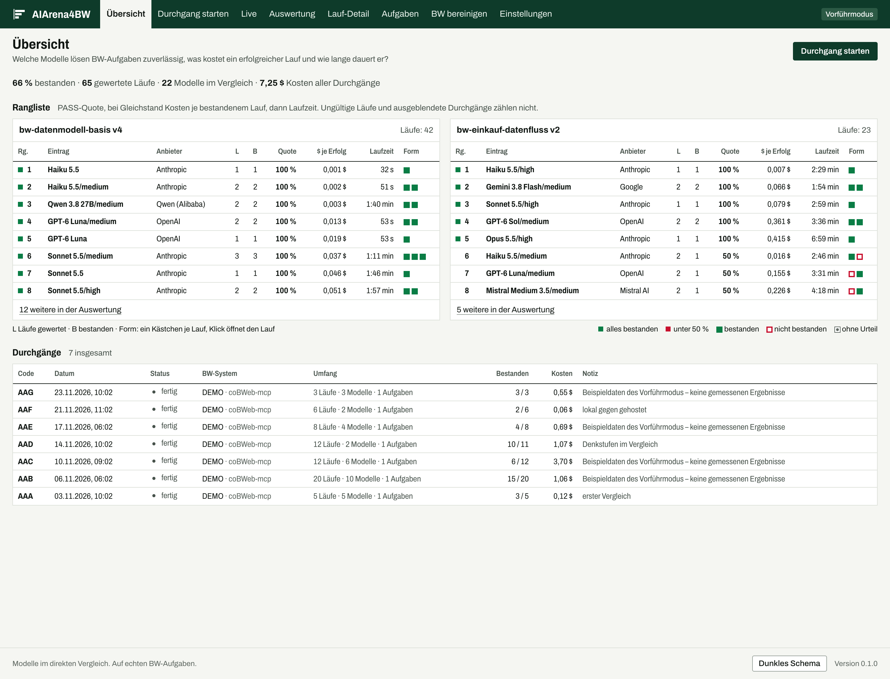
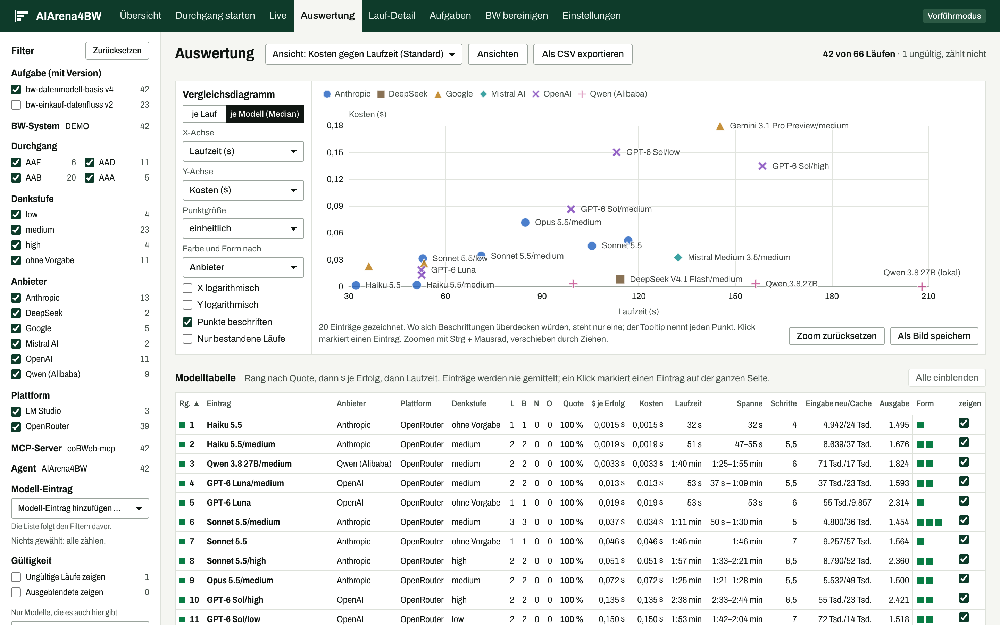
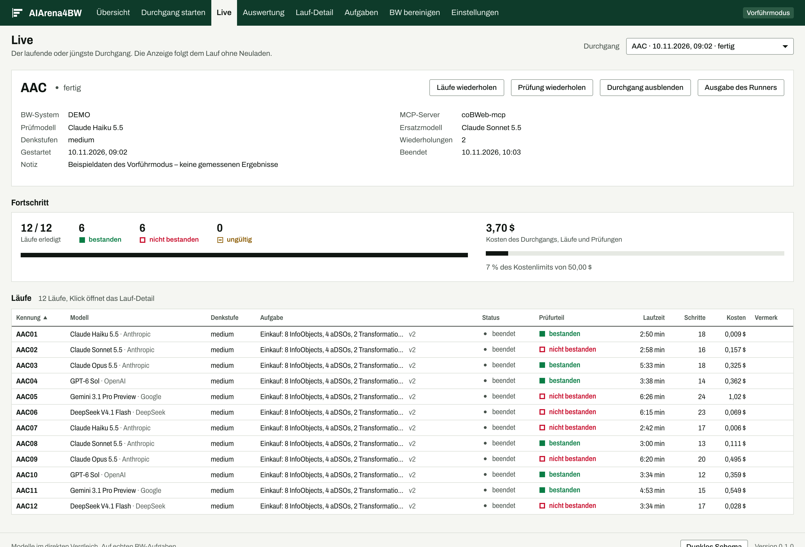

# AIArena4BW

**Modelle im direkten Vergleich. Auf echten BW-Aufgaben.**

AIArena4BW lässt KI-Modelle dieselbe Modellierungsaufgabe in einem SAP-BW/4HANA-System lösen und
misst, was dabei herauskommt: Erfolg, Laufzeit, Tokens und Kosten. Jedes Modell arbeitet über einen
BW-MCP-Server; ein anderes Modell prüft anschließend im BW nach, ob das Ergebnis stimmt.



Die Fragen dahinter:

- Welche Modelle lösen BW-Aufgaben zuverlässig?
- Was kostet ein erfolgreicher Lauf, und wie lange dauert er?
- Wie stark streuen die Ergebnisse bei Wiederholung?
- Was bewirken Änderungen an Aufgabe, MCP-Server, Plattform oder Denkstufe?

> **Nur mit Test- und Demosystemen verwenden.** Die Modelle legen im BW selbstständig Objekte an,
> ändern und aktivieren sie. Über externe Plattformen gehen Aufgabentext, Werkzeugbeschreibungen und
> die Antworten des BW-Systems (Objektnamen, Metadaten) an die Plattform und den Modellanbieter.
> Vor dem ersten Durchgang: [Sicher einrichten](#sicher-einrichten) und
> [Haftungsausschluss](#haftungsausschluss).

## Was die App kann

- **Durchgänge** aus Aufgaben × Modellen × Denkstufen × Wiederholungen, gegen ein wählbares
  BW-System und einen wählbaren MCP-Server; Läufe nacheinander, live verfolgbar, abbrechbar.
- **Eigener Agent:** Die App steuert das Modell selbst. Es sieht nur die Werkzeuge des MCP-Servers,
  keine Dateien, keine Shell, kein Internet. Alle Modelle bekommen denselben Systemtext.
- **Prüfung durch ein anderes Modell**, das nur lesende Werkzeuge erhält. Ein Modell prüft nie sich
  selbst. Jeder Prüfpunkt wird einzeln festgehalten.
- **Auswertung** mit interaktivem Vergleichsdiagramm, Kennzahlen je Modell, Rangliste, Lauf-Detail
  mit Zeitleiste und vollständigem Protokoll, gespeicherten Ansichten und CSV-Export.
- **Ehrliche Zahlen:** Läufe, die an Guthaben, Ratenlimit, Netz oder BW-Ausfall scheiterten, zählen
  nicht. Ein fehlender Preis erscheint als „kein Preis“, nie als 0 $. Die Herkunft der Kosten
  (abgerechnet oder berechnet) steht an jedem Lauf.
- **Plattformen:** OpenRouter, Anthropic, SAP AI Core und alles OpenAI-Kompatible (LM Studio,
  Ollama, vLLM …).
- **Aufräumen:** Die Objekte eines Durchgangs lassen sich im BW suchen und nach Bestätigung löschen.



| Plattformtyp | Stand |
|---|---|
| OpenRouter | im Echtbetrieb geprüft |
| Anthropic | gegen Nachbau geprüft |
| SAP AI Core (Orchestration Service) | gegen Nachbau geprüft |
| OpenAI-kompatibel (LM Studio u. a.) | gegen Nachbau geprüft |

Die Bilder zeigen den Vorführmodus mit frei erfundenen Beispieldaten.

## Voraussetzungen

- [uv](https://docs.astral.sh/uv/) (bringt Python mit)
- ein SAP-BW/4HANA-System zum Testen
- ein BW-MCP-Server, voreingetragen ist [coBWeb](https://github.com/oliverluette/coBWeb-mcp)
  (Node ≥ 22)
- Zugang zu mindestens einer LLM-Plattform

Erprobt unter macOS. Unter Linux braucht der Schlüsselbund einen Secret-Service-Dienst (etwa GNOME
Keyring); Windows ist nicht erprobt. Die Oberfläche gibt es nur auf Deutsch. Node wird für die App
selbst nicht gebraucht, nur für coBWeb und um an der Oberfläche zu entwickeln.

## Start

```bash
git clone https://github.com/oliverluette/AIArena4BW.git && cd AIArena4BW
uv sync
uv run aiarena4bw            # öffnet http://127.0.0.1:8321
```

Erst einmal nur ansehen, ohne BW-System und ohne Schlüssel:

```bash
uv run aiarena4bw demo       # Beispieldaten, frei erfunden
```

## Einrichten

Alles Weitere geschieht in der App unter **Einstellungen**. Die Übersicht zeigt, was noch fehlt.

1. **BW-System:** URL, Mandant, Benutzer, Passwort, Sprache. Dazu die InfoArea, unter der die
   Tests stattfinden (Vorgabe `ZBENCH_AI`; sie muss im BW existieren), und das Präfix der
   Objektnamen (Vorgabe `ZB`). Nimm einen eigenen Benutzer mit begrenzten Rechten (siehe unten).
2. **MCP-Server:** JSON wie bei LM Studio oder Claude Desktop. Im Eintrag `coBWeb-mcp` den Pfad zu
   `dist/transport/stdio.js` eintragen. Die BW-Verbindung steht als Platzhalter im JSON
   (`${BW_URL}`, `${BW_USER}`, `${BW_PASSWORD}` …) und wird beim Start aus dem gewählten BW-System
   gefüllt. Mit „Testen“ zeigt die App die Werkzeuge des Servers und ihre Token-Last.
3. **LLM-Plattform:** Typ wählen, Schlüssel eintragen, Katalog abrufen, Modelle vorauswählen.
4. **Prüfmodell** und Ersatzmodell festlegen.

Schlüssel und Passwörter liegen im Schlüsselbund des Betriebssystems, nicht in der Datenbank und
nicht in Dateien. Die App lauscht nur auf `127.0.0.1` und sendet nichts außer den Modellanfragen.

## Sicher einrichten

Die Modelle arbeiten selbstständig im BW. Begrenze deshalb an drei Stellen, was sie dürfen.

### Im BW: ein eigener Benutzer

Die eigentliche Grenze ist die Berechtigung im BW; alles Weitere ist eine zweite Sicherung.

- ein eigener Benutzer nur für die AIArena4BW, nur im Test- oder Demosystem, nie im Produktivsystem;
- Schreibrechte nur in der Test-InfoArea (Vorgabe `ZBENCH_AI`, darunter die Lauf-InfoAreas
  `ZBENCH_…`) und für Objektnamen mit dem Präfix (Vorgabe `ZB`), über die Berechtigungsobjekte der
  BW-Modellierung (`S_RS_*`, etwa `S_RS_ADSO`, `S_RS_IOBJ`, `S_RS_HCPR`);
- Entwicklung nur im Paket `$TMP` (`S_DEVELOP`), keine Transportaufträge (`S_TRANSPRT`);
- keine Rechte auf Ladeprozesse, Prozessketten und Geschäftsdaten.

Eine fertige Rolle liefert das Projekt nicht mit. Welche Felder die Berechtigungsobjekte in deinem
Release haben, prüfst du in der Rollenpflege (PFCG).

### Im MCP-Server

Für coBWeb trägt die App beim ersten Start diese Werte ein:

| Variable | Wert | Wirkung |
|---|---|---|
| `COBWEB_ALLOW_WRITES` | `true` | Die Modelle dürfen anlegen und aktivieren. |
| `COBWEB_ALLOWED_INFOAREAS` | `${BW_PARENT_AREA},${BW_AREA_GLOB}` | nur die Test-InfoArea und die InfoAreas der Läufe |
| `COBWEB_ALLOWED_PACKAGES` | `$TMP` | nur lokale Objekte, nichts Transportierbares |
| `COBWEB_TOOLS` | `bw_search,bw_read,bw_context,bw_describe,bw_write,bw_activate,bw_system` | ohne `bw_transport`, `bw_data` und `bw_run` |
| `COBWEB_ALLOW_WRITES` (Umgebung der Prüfung) | `false` | Das Prüfmodell liest nur. |

Wer jeden Schreibzugriff nachvollziehen will, setzt zusätzlich `COBWEB_AUDIT_FILE` auf eine Datei;
coBWeb schreibt dann je geschriebenem Objekt eine Zeile. Die App warnt unter **Einstellungen >
MCP-Server** und in der Vorschau eines Durchgangs, wenn ein coBWeb-Eintrag mehr darf als nötig. Bei
anderen MCP-Servern kann sie das nicht prüfen; stelle dort Entsprechendes im Server selbst ein.

### In der App und bei der Plattform

- Vor dem ersten Durchgang zeigt die App einen Nutzungshinweis, der einmal zu bestätigen ist
  (auf der Kommandozeile mit `aiarena4bw run --accept-notice`).
- Das Kostenlimit je Durchgang steht auf 5 $ (Einstellungen > Vorgaben). Es hält einen Durchgang
  an, sobald die Grenze erreicht ist. Setze zusätzlich eine Ausgabegrenze bei der Plattform, bei
  OpenRouter etwa ein Limit für den Schlüssel.
- **BW bereinigen** löscht nur Objekte, deren Namen zu den Läufen passen, und erst nach
  Bestätigung.

## Ein Durchgang

Unter **Durchgang starten** Aufgaben und Modelle wählen. Die Vorschau nennt den Code des Durchgangs,
die Zahl der Läufe und eine Kostenschätzung aus früheren Läufen. Unten auf der Seite lässt sich ein
früherer Durchgang als Vorlage wählen; „Zurücksetzen“ stellt die Vorgaben wieder her. Der Durchgang läuft in einem eigenen
Prozess weiter, auch wenn der Browser geschlossen wird.



Jeder Durchgang bekommt einen Code (AAA, AAB, …), jeder Lauf eine Kennung (AAA01). Sie steckt in
allen Objektnamen, die das Modell anlegt (`ZBAAA01CU`, InfoArea `ZBENCH_AAA01`), damit Läufe sich
nicht in die Quere kommen und sich später wieder entfernen lassen.

Ohne Oberfläche:

```bash
uv run aiarena4bw run --tasks bw-datenmodell-basis --models "claude-haiku,gemini-3.8-flash" --repeats 2
uv run aiarena4bw list batches
uv run aiarena4bw cancel --batch AAB
```

## Aufgaben

Eine Aufgabe ist ein Ordner unter `tasks/`:

| Datei | Inhalt |
|---|---|
| `task.yaml` | Version, Titel, Zeitlimit, Zahl der Prüfpunkte, Zuordnung der Werkzeuge zu Anforderungen |
| `prompt.md` | der Auftrag an das Modell |
| `verify.md` | der Auftrag an das Prüfmodell; endet mit `VERDICT: PASS` oder `VERDICT: FAIL` |

Platzhalter in beiden Texten: `{RUN}`, `{MODEL}`, `{MCP}`, `{SYSTEM}`, `{PREFIX}`, `{AREA}`,
`{PARENT_AREA}`. Mitgeliefert sind zwei Aufgaben:

| Aufgabe | Inhalt | Zeitlimit |
|---|---|---|
| `bw-datenmodell-basis` | InfoArea, 3 InfoObjects, 1 aDSO, aktivieren (6 Prüfpunkte) | 900 s |
| `bw-einkauf-datenfluss` | 8 InfoObjects, 4 aDSOs, 2 Transformationen, 2 DTPs mit Filter, CompositeProvider, 3 Queries (13 Prüfpunkte) | 2400 s |

Aufgaben lassen sich in der App anlegen und bearbeiten. Eine Fassung, mit der schon Läufe liefen,
wird nie überschrieben: Änderungen entstehen als neue Version, alte Ergebnisse bleiben ihrer Fassung
zugeordnet.

## Wie gemessen wird

- **Laufzeit** vom ersten Modellaufruf bis zur letzten Antwort, getrennt nach Wartezeit auf das
  Modell und auf Werkzeuge.
- **Tokens** einheitlich über alle Plattformen: Eingabe gesamt, davon aus dem Cache gelesen,
  Ausgabe, Denk-Tokens. Prompt-Caching ist eingeschaltet, wo die Plattform es bietet.
- **Kosten** wie von der Plattform gemeldet (OpenRouter), sonst aus Tokens × Preis des Modells.
- **Bestanden** heißt: Das Prüfmodell hat alle Prüfpunkte im BW bestätigt.
- Zeitlimit, Schrittlimit und ein überschrittenes Kontextfenster sind Ergebnisse des Modells und
  zählen. Störungen der Umgebung zählen nicht.
- Ein Modell mit anderer Denkstufe, über einen anderen MCP-Server oder mit anderem Agenten ist ein
  eigener Eintrag und wird nie mit anderen gemittelt.

## Entwicklung

```bash
uv run pytest                       # Backend, ohne Netz, ohne BW, ohne Schlüssel
uv run ruff check . && uv run ruff format --check .
npm --prefix frontend install
npm --prefix frontend run dev       # Oberfläche mit Vite; Backend: uv run aiarena4bw serve --reload
npm --prefix frontend run typecheck && npm --prefix frontend run lint && npm --prefix frontend run test
npm --prefix frontend run build     # schreibt nach src/aiarena4bw/web/
npm --prefix frontend run e2e       # Oberflächentest mit Playwright gegen Nachbauten
```

Aufbau: `src/aiarena4bw/` (Backend: Agent, Plattform-Adapter, Runner, Prüfung, Auswertung,
Schnittstelle), `frontend/` (React, TypeScript, ECharts), `tasks/`, `tests/` (mit nachgebauter
Plattform und nachgebautem MCP-Server). Gestaltungsregeln stehen in `DESIGN.md`, wie man mitwirkt in
[CONTRIBUTING.md](CONTRIBUTING.md), wie man eine Sicherheitslücke meldet in
[SECURITY.md](SECURITY.md).

## Entstehung

Dieses Projekt wurde mit Claude Code erstellt: Anforderungen und Plan zuerst, dann die Umsetzung in
Etappen, jede mit Tests und Abnahme.

## Haftungsausschluss

AIArena4BW ist ein Open-Source-Projekt und wird ohne jede Gewähr bereitgestellt (siehe
[LICENSE](LICENSE)). Die App lässt KI-Modelle selbstständig Objekte in einem SAP-System anlegen,
ändern und aktivieren; beim Bereinigen löscht sie Objekte. Für die Wahl des Systems, die
Berechtigungen, die Daten, die an Plattformen und Modellanbieter gehen, und die entstehenden Kosten
bist du selbst verantwortlich. Die Ergebnisse eines Durchgangs sind Messungen unter deinen
Bedingungen, keine allgemeine Bewertung eines Modells.

## Marken

AIArena4BW ist kein Produkt der SAP SE und steht in keiner Verbindung zu ihr. SAP, SAP BW/4HANA und
weitere genannte SAP-Produkte sind Marken oder eingetragene Marken der SAP SE in Deutschland und
anderen Ländern. Genannte Modelle und Plattformen sind Marken ihrer jeweiligen Inhaber.

## Lizenz

MIT, siehe [LICENSE](LICENSE).
